<p align="center">
  
</p>

<h1 align="center">Mac Cleaner</h1>

<p align="center">
  <strong>The assistant that watches over your Mac.</strong><br>
  Cleaner, antivirus, port manager and system monitor in one native app.<br>
  No subscription. No account. No tracking. Everything stays on your Mac.
</p>

<p align="center">
  <a href="https://github.com/Shayan5422/MacCleaner/releases/latest"></a>
  <a href="https://github.com/Shayan5422/MacCleaner/actions/workflows/ci.yml"></a>
  
  
  
  
  <a href="LICENSE"></a>
</p>

<p align="center">
  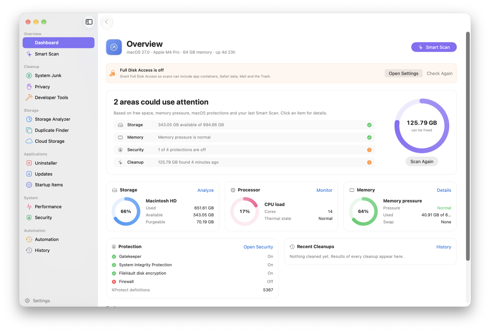
</p>

Mac Cleaner brings together what premium Mac cleaners and security suites do — junk cleanup, a complete uninstaller, storage visualization, duplicate finding, startup and performance management, **an antivirus with free, self-updating virus definitions and real-time shields**, PortPilot's **port manager**, a **startup guard**, security and privacy checks, developer cleanup and automation — in one native SwiftUI app that keeps an eye on things from the menu bar.

It's built around two rules: **your data is safer than any amount of free space**, and **never claim more protection than you provide.** You review everything before it's removed, personal files go to the Trash, every cleanup can be undone, and every check says plainly what it can and can't see.

## Features

| | |
|---|---|
| 🛡 **Antivirus** | Mac Cleaner's own engine for the free **ClamAV® signature databases** (about 3.6 million signatures) and **abuse.ch MalwareBazaar** hashes. Quick, Full and custom scans, inside archives and universal binaries. Definitions are signature-verified and update themselves (through ClamAV's **freshclam** when installed). Threats go to a locked **Virus Chest**. |
| 📡 **Real-time shields** | **File Shield** scans new files in Downloads, Desktop, Documents, Applications and launch agent folders as they appear. **Download Shield** checks where a download came from, **Web Shield** warns when a browser opens a known malware site, and **Network Shield** flags connections to known malicious servers (abuse.ch URLhaus and ThreatFox). |
| 🌐 **Ports & Network** | Every open port grouped by project, with framework, launch origin and resource use. Find what uses a port and stop it safely — including servers launchd, pm2 or Docker would restart. Live connections per process, and a Wi-Fi and network check. Based on [PortPilot](https://github.com/Shayan5422/PortPilot). |
| 🧭 **Menu bar assistant** | Stays in the menu bar when you close the window: protection status, open ports with Stop, disk and CPU, Smart Scan, updates and an Activity feed of everything Mac Cleaner noticed. |
| ✨ **Smart Scan** | One scan across junk, leftovers, large files, duplicates, startup items, security, privacy and developer caches. Items found by several checks are counted once. |
| 🧹 **System Junk** | App and macOS caches, temporary files, logs, crash reports, Xcode build data, device firmware, Mail attachment copies, installers and old downloads — each with what it is and what removing it means. |
| 🗑 **Uninstaller** | Removes apps with their preferences, caches, containers and support files. Conservative matching protects shared vendor data; running apps are detected; leftovers of already-deleted apps are found. |
| 📊 **Storage Analyzer** | Interactive treemap and sunburst, largest and oldest files, categories, Quick Look, search, Trash and "Move to…", external drives. APFS clones and hard links are never counted twice. |
| 🪞 **Duplicate Finder** | Exact duplicates by size → partial hash → SHA-256, plus visually similar photos with Apple Vision (never auto-selected). Hard links aren't treated as copies. |
| ⏻ **Startup Items** | Login items, your launch agents (enable/disable via `launchctl`), app background items and system-wide items, with developer, status and resource use. **Startup Guard** shows what opened automatically at your last login and why, records every startup item that's added, removed or changed, and lists every background item macOS knows about. |
| 📈 **Performance** | Live CPU (per core), memory pressure and composition, swap, disk and network throughput, battery health, thermal state and top processes. Optional menu bar monitor and alerts. |
| 🛡 **Security** | Gatekeeper, SIP, FileVault, firewall and XProtect status, persistence locations, code signatures, quarantined downloads and known adware rules — threats, suspicious items and information clearly separated. |
| ✋ **Privacy** | Caches, history, cookies, website data and sessions for Safari, Chrome, Edge, Brave, Arc, Vivaldi, Opera and Firefox; recent items; download history. Passwords and bookmarks are never touched. |
| ☁️ **Cloud Storage** | iCloud Drive, Google Drive, Dropbox and OneDrive: what's stored locally vs. in the cloud, and "Remove Download" that keeps files in the cloud. |
| ⬇️ **Updates** | App versions with real update information from Sparkle feeds, the App Store and Homebrew — only when you ask. Mac Cleaner checks for its own new versions and verifies the download's checksum, Developer ID signature and notarization before installing. |
| 🔨 **Developer Tools** | Xcode DerivedData, archives, device support, simulators, Homebrew, npm, pnpm, Yarn, pip, uv, Docker, Gradle, Maven — using the tools' official commands where they exist. |
| ⏰ **Automation** | Daily, weekly or monthly cleaning, low-storage triggers, junk alerts, dry runs and a heads-up before cleaning. Only regenerable data is ever cleaned automatically. |
| ↩️ **History & Undo** | Every cleanup is recorded; anything moved to the Trash can be put back. |

## Screenshots

<table>
  <tr>
    <td>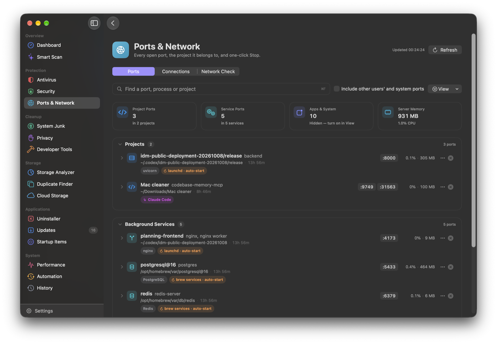</td>
    <td>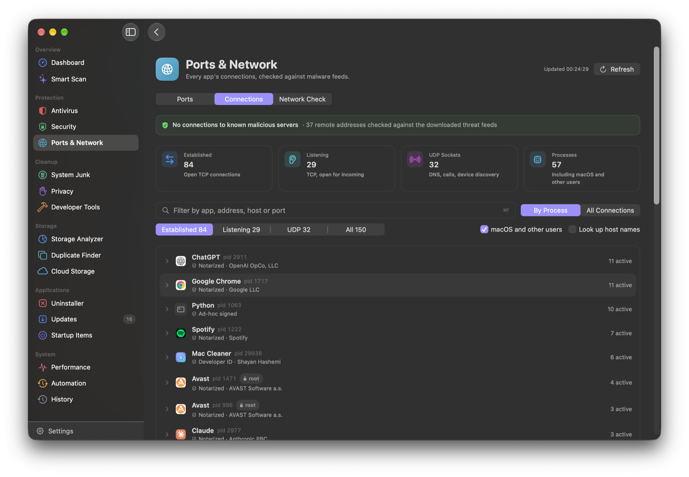</td>
  </tr>
  <tr>
    <td>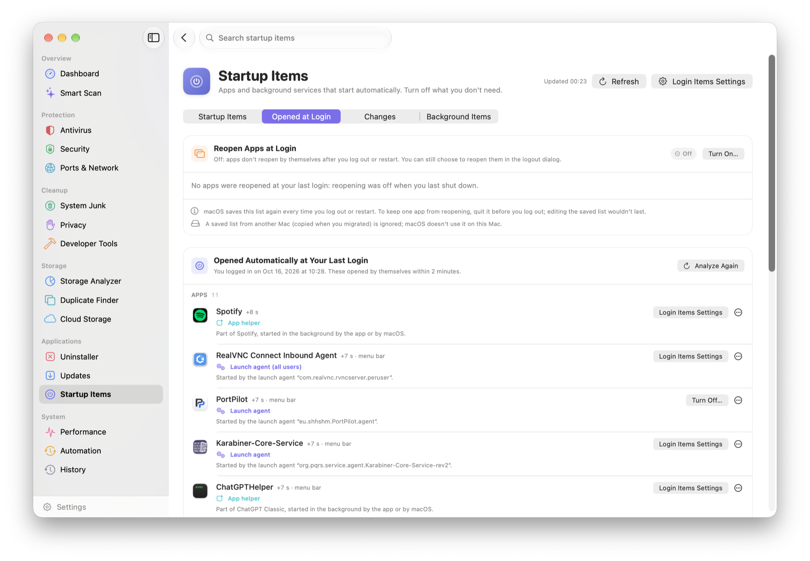</td>
    <td>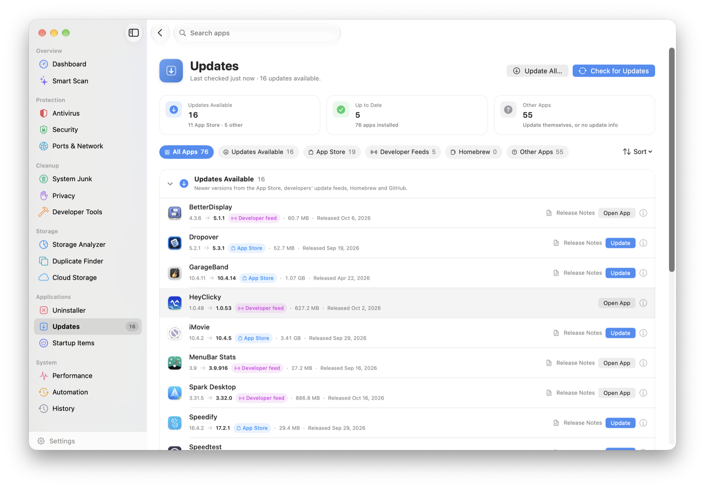</td>
  </tr>
  <tr>
    <td>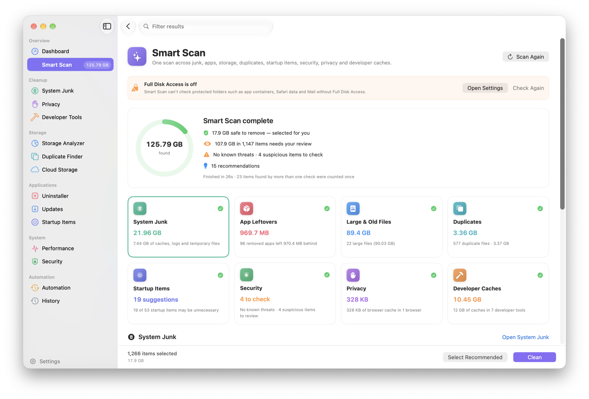</td>
    <td>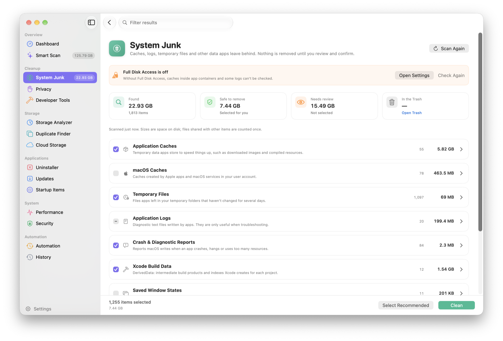</td>
  </tr>
  <tr>
    <td>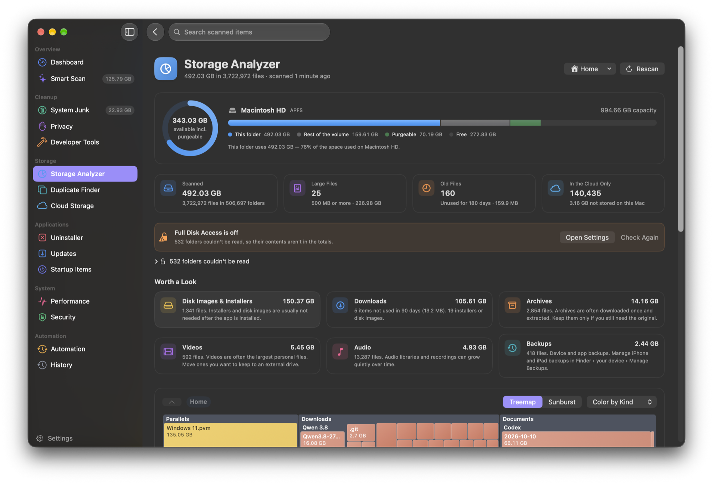</td>
    <td>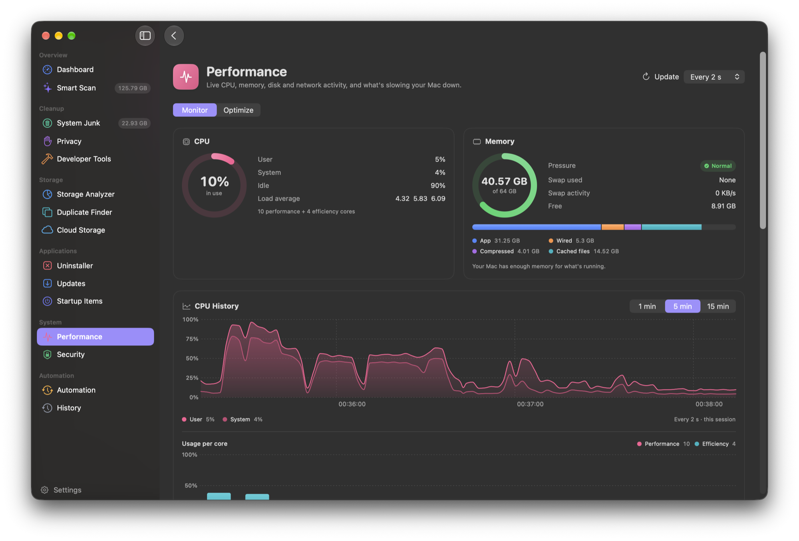</td>
  </tr>
  <tr>
    <td>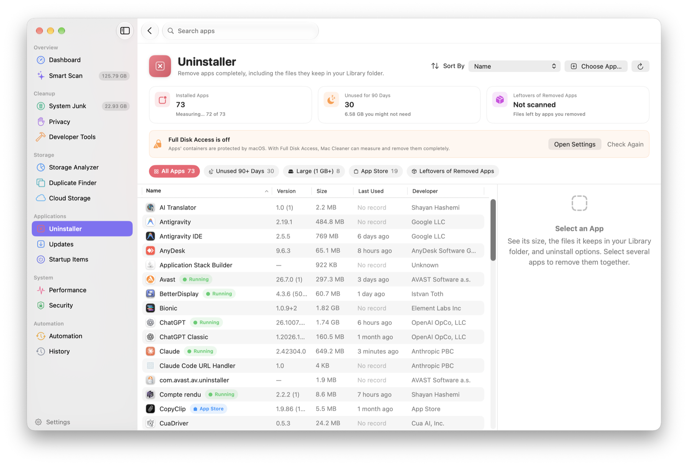</td>
    <td>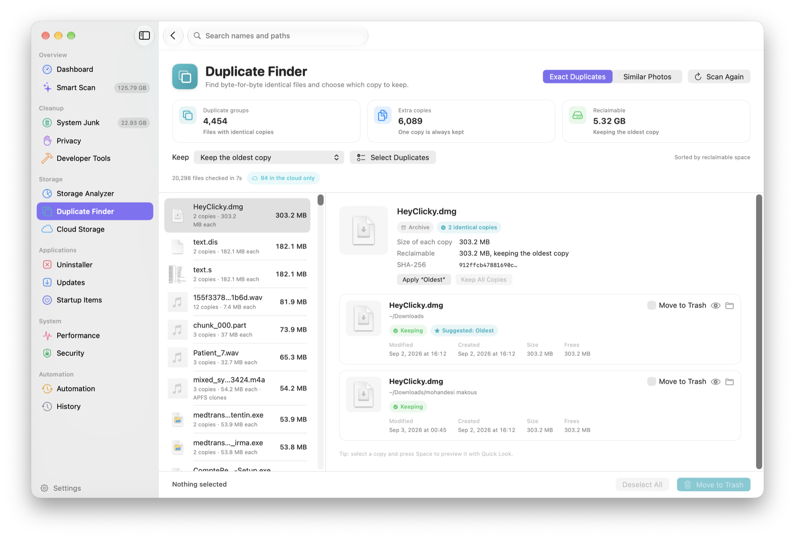</td>
  </tr>
  <tr>
    <td>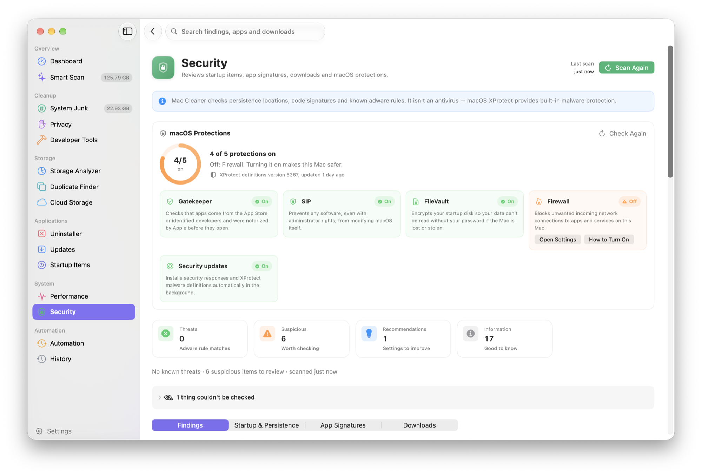</td>
    <td>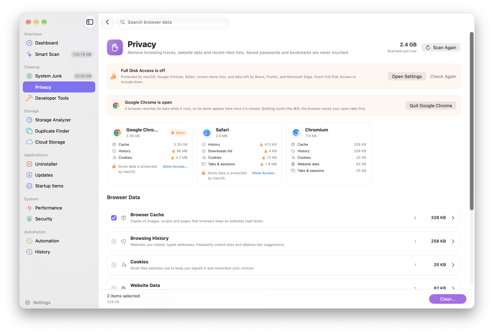</td>
  </tr>
  <tr>
    <td>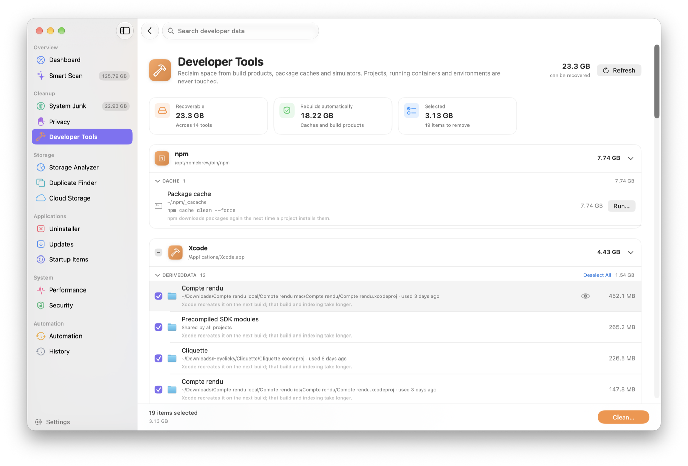</td>
    <td>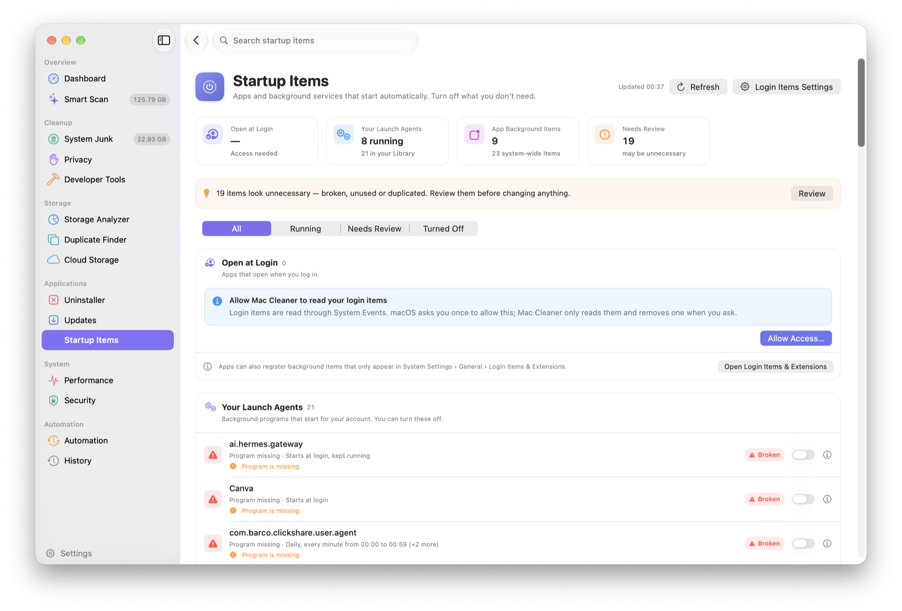</td>
  </tr>
</table>

<p align="center">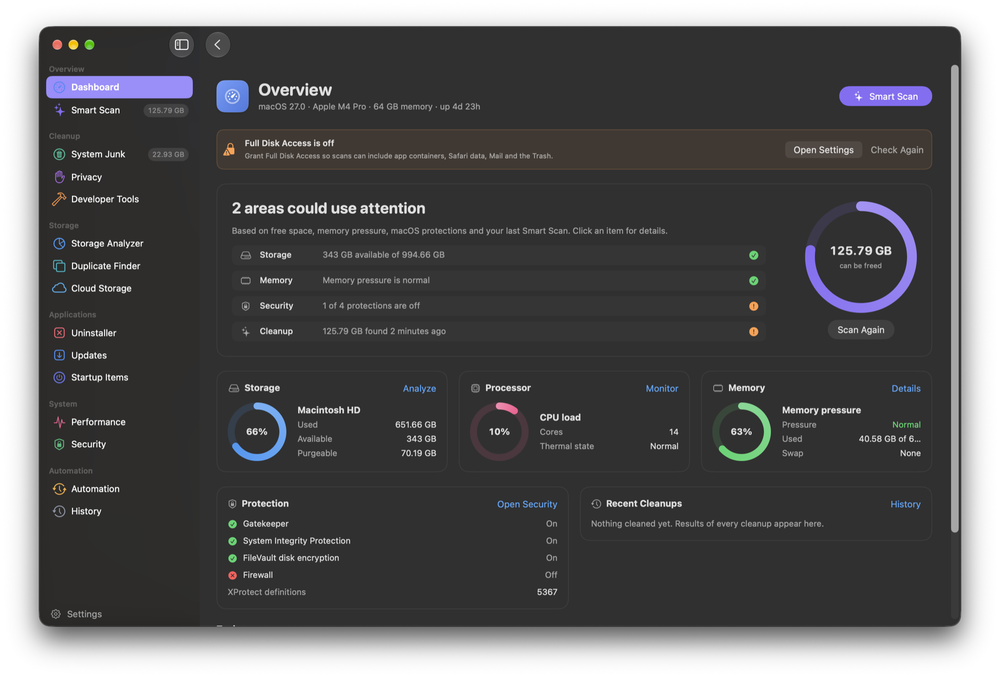</p>

## Safety first

* **Nothing is removed without your review.** Results explain what each item is and what happens if it's removed. Only data apps regenerate automatically is pre-selected.
* **Personal files, apps and app settings always go to the Trash**, and **History** can put them back.
* **Built-in protection rules** refuse to touch macOS, your Documents/Desktop/Photos, keychains, Mail, Messages, cloud folders, browser passwords and bookmarks — checked again immediately before every removal.
* **Race-safe deletion:** each item is re-identified (device + inode) right before removal, paths through symbolic links are refused, and folders are deleted through file descriptors so a swapped-in symlink can't redirect deletion.
* **Items open in running apps are skipped.**
* **No fake optimizations:** no "RAM cleaners", no invented health scores, no fabricated results. When macOS doesn't allow something, Mac Cleaner says so and points you to the right setting.

See [docs/PERMISSIONS.md](docs/PERMISSIONS.md) for every permission, what is never removed, and the macOS limitations the app works within.

## Install

1. Download **Mac-Cleaner-x.y.z.dmg** from the [latest release](https://github.com/Shayan5422/MacCleaner/releases/latest).
2. Open it and drag **Mac Cleaner** to **Applications**.
3. *(Recommended)* Give it **Full Disk Access** in System Settings › Privacy & Security, so scans can include app containers, Safari data, Mail and the Trash. The app works without it and tells you what it couldn't check.

Requires macOS 14 Sonoma or later; universal for Apple silicon and Intel. Releases are signed with Developer ID and notarized by Apple. Developed and tested on macOS 27 (Apple M4 Pro).

## Build from source

```bash
git clone https://github.com/Shayan5422/MacCleaner.git
cd MacCleaner
open MacCleaner.xcodeproj   # then press ⌘R
```

Built with Xcode 27 (Swift 6, strict concurrency). Run the 400+ tests with:

```bash
xcodebuild -project MacCleaner.xcodeproj -scheme MacCleaner -destination 'platform=macOS' test
```

Signing, notarization and the release pipeline are described in [docs/RELEASING.md](docs/RELEASING.md); the code structure in [docs/ARCHITECTURE.md](docs/ARCHITECTURE.md).

## Privacy

Mac Cleaner has no analytics, no telemetry and no accounts. Scanning, cleaning and virus scans run entirely on your Mac; nothing about your files, apps or browsing is ever sent anywhere. The only network requests download public data or check versions, and each can be turned off in Settings:

| Request | When | What is sent |
|---|---|---|
| Virus definitions from ClamAV (`database.clamav.net`, via freshclam when installed) | Automatically, at most every few hours, once you've downloaded them | Nothing but the request itself |
| Threat feeds from abuse.ch (MalwareBazaar, URLhaus, ThreatFox) | With the definitions | Nothing but the request itself |
| Mac Cleaner's own update check (`api.github.com`) | Once a day | The app's version in the User-Agent |
| Update checks for your apps (App Store, developers' Sparkle feeds) | Only when you click "Check for Updates" | The apps' identifiers to the App Store lookup API |
| Reverse DNS for connections | Only if you turn it on in Ports & Network | The connections' IP addresses, to your DNS server |

Web Shield reads your browsers' history on your Mac to spot known malware sites; it keeps only matches and never stores or sends what you visited. The activity log stays on your Mac and records operations, never file contents.

## Keyboard shortcuts

| Shortcut | Action |
|---|---|
| ⌘1 … ⌘0 | Dashboard, Smart Scan, System Junk, Storage, Duplicates, Uninstaller, Performance, Security, Privacy, Developer Tools |
| ⇧⌘S | Start Smart Scan |
| ⌘R | Scan / scan again on the current page |
| ⌘↩ | Clean the selection |
| ⌘[ | Back |
| ⌘, | Settings |

## License

Mac Cleaner is available under the [MIT License](LICENSE).
